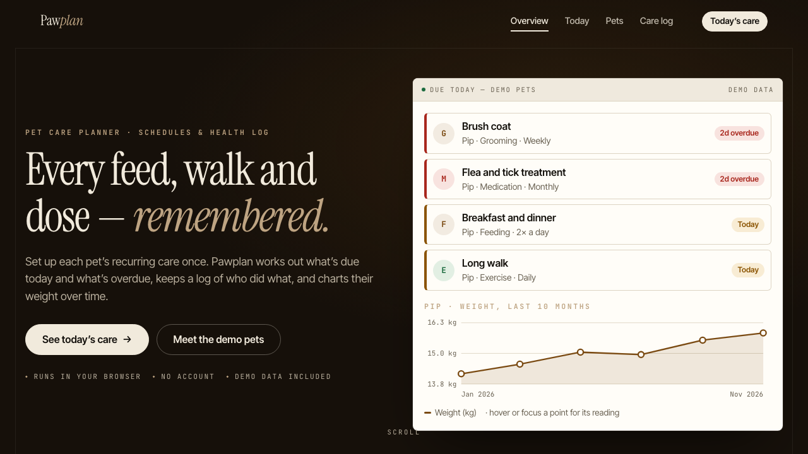
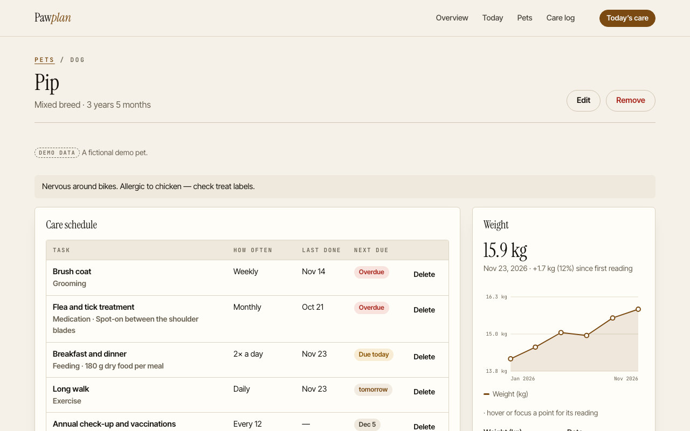
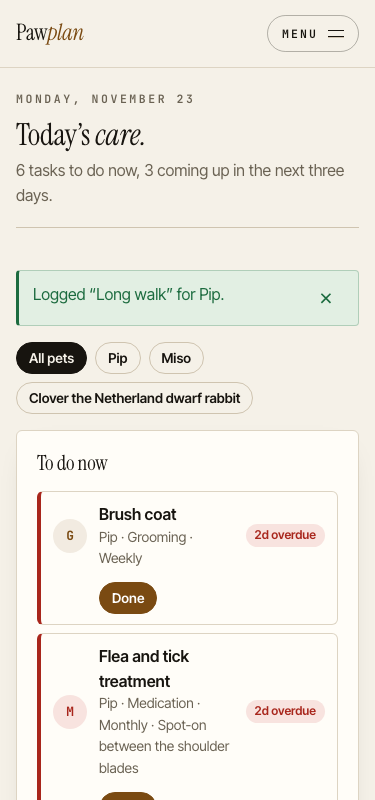

# Pawplan

A pet care planner: profiles for each animal, recurring care tasks with due and overdue tracking, a care log with notes, and a weight chart. Not veterinary advice.

**Live demo:** [https://pawplan.vercel.app/](https://pawplan.vercel.app/) — runs entirely in your browser; demo data is fictional and labelled.



| Pet profile | Mobile |
| --- | --- |
|  |  |

## Run it

```bash
npm install
npm run dev        # http://localhost:5203
npm test
npm run build
npm run test:e2e   # Playwright smoke test (npm run e2e:install once if Chromium is missing)
```

## Main workflow

1. The app opens with three labelled **demo pets** — a dog, a senior cat and a rabbit with a long name and no birth date — plus three weeks of care history. **Pets → Clear demo pets** removes them.
2. **Pets → Add pet** → name, species, breed, birth date (optional) and notes for anyone caring for them.
3. On a pet’s page, **add care tasks**: category, repeat every N days, weeks or months, times per day for daily tasks, first due date and instructions. Record **weights** to build the chart.
4. **Today** → everything overdue or due today across pets (filter by pet), with **Done** buttons, and what’s coming in the next three days.
5. **Care log** → every completed task with search, pet/category/period filters, sorting, pagination, inline notes and CSV export.

## Rules

- A task’s next due date is one interval after the last time it was **actually done**; before the first time, it’s the first due date.
- Monthly intervals clamp to month end (31 Jan + 1 month → 28/29 Feb).
- Daily tasks with several times a day stay due until ticked that many times today.
- Overdue = due before today. Soon = due within three days.
- Age is shown in years and months; weights must be 0–200 kg and not in the future. A second reading on the same day replaces the first.

## Design

Shared editorial system: Instrument Serif display type, Inter Tight interface text, category initials coloured by type, an ink hero whose preview is the real due list and weight chart, and a warm paper workspace. The weight chart has labelled axes with units, a legend, and readings on hover or keyboard focus. Motion is disabled under `prefers-reduced-motion`.

## Tests

- `src/lib/care.test.ts` — intervals and labels, due dates from the last completion, multi-daily tasks, due states, agenda ordering, age, weight trend, validation.
- `src/App.test.tsx` — logging from Today, pet filter, empty state and adding a pet, adding a task and weight, care-log category filter.
- `e2e/smoke.spec.ts` — landing, log care with reload persistence, add a pet with a twice-daily task and a weight, pet page, care log, plus 375px layout checks.

## Limitations

- No reminders or notifications.
- One device only; carers can’t share a live schedule.
- Pawplan does not give medical, dosage or dietary advice.

## Future improvements

- Printable sitter sheet per pet; attach vet documents.

## Licence

MIT — see [LICENSE](LICENSE).
